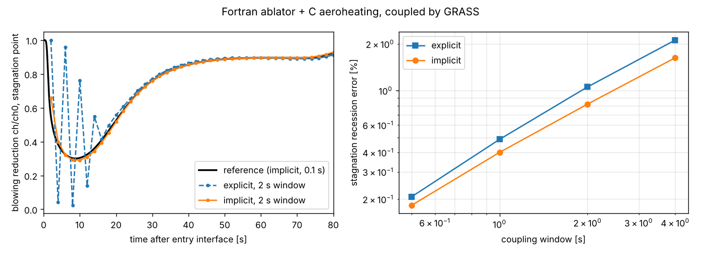

# mock_icarus: a Fortran material-response code under GRASS

This demo answers one question: **what does it look like to take an existing
Fortran code, run it from GRASS, and couple it to another code?**

There are two stand-in "legacy" codes. Neither knows anything about GRASS or
Rust:

| code | language | what it models |
|---|---|---|
| [`fortran/ablator.f90`](fortran/ablator.f90) | Fortran 2008 | 1D pyrolyzing ablator: conduction through a virgin/char mix, Arrhenius decomposition with a heat of pyrolysis, a surface energy balance with re-radiation, and char recession from diffusion-limited oxidation (B'c). Backward Euler with a tridiagonal solve. Several independent columns ("stations") per instance. |
| [`c/aero.c`](c/aero.c) | C99 | Engineering aeroheating: a ballistic entry trajectory (RK4), Sutton-Graves stagnation heating, a laminar distribution over the nose, and the laminar blowing correction driven by the wall mass injection. |

> **This is not Icarus.** The ablator is a few hundred lines written to have
> the *shape* of a production material-response code: global module state,
> its own integrator, a flat C interface, and its own save/restore routines.
> The physics is the textbook subset (single-reaction pyrolysis, gas leaves
> instantly, no Darcy flow, no B' tables, and recession by uniform contraction
> of the column). The material defaults are PICA-like, but the numbers are only
> plausible, not validated.

The two codes are coupled through the blowing rate. The ablator needs the
heat-transfer coefficient `ch = ρₑuₑC_H` and the recovery enthalpy from the
flow code. The flow code needs the ablator's pyrolysis-gas and char mass flux
to compute how much that blowing reduces `ch`. Neither code applies the
correction on its own side, so the problem is genuinely two-way.

## How a Fortran code becomes a GRASS plugin

It takes three layers, and only the last one involves GRASS.

**1. The Fortran exposes a C interface.** This is plain `iso_c_binding`.
If the code already has a C API, or a Python one through f2py, most of this
already exists.

```fortran
integer(c_int) function icarus_create(nstations, ncells, thickness, t0) bind(C)
subroutine icarus_set_bc(h, s, ch, h_r) bind(C)
integer(c_int) function icarus_step(h, dt) bind(C)          ! 0 ok, 2 non-finite, 3 burn-through
subroutine icarus_get(h, s, out) bind(C)                      ! T_wall, T_back, recession, mdot, ...
subroutine icarus_save_state(h, buf) bind(C)                  ! for checkpoints and implicit coupling
subroutine icarus_restore_state(h, buf) bind(C)
```

**2. A safe Rust owner** ([`src/lib.rs`](src/lib.rs), `Ablator`). It holds
the `extern "C"` declarations, frees the instance on drop, and turns status
codes into `Result`s. [`build.rs`](build.rs) compiles the Fortran with
`gfortran` and links it. Nothing in this layer is GRASS-specific.

**3. A GRASS plugin** (`AblatorPlugin`, about 60 lines). It reads an
`[ablator]` TOML section and publishes typed resources:

* `SurfaceBc` (input): `ch` and `h_r` per station.
* `Surface` (output): wall temperature, back-face temperature, recession, `mdot` and fluxes per station.

It registers one system that sets the boundary condition, calls
`icarus_step` and reads the outputs back. Everything else in GRASS works with
those resources: the coupling layer, checkpointing, output, and config
documentation. The C aero code gets the same treatment (`AeroPlugin`).

## 1. Use it standalone: an arc-jet test from TOML

```sh
cargo run --release --bin arcjet -- arcjet.toml
```

[`arcjet.toml`](arcjet.toml) holds the whole test. It defines the coupon
(`[ablator]`) and the facility condition (`[arcjet]`: 200 W/cm², 20 MJ/kg).
The `[[run]]` stages are a 30 s exposure followed by a 60 s cooldown, where
the cooldown stage just overrides `arcjet = { q_cw = 0.0 }`. The file also
sets terminal output and a checkpoint at the end of the exposure. The only
code in [`src/bin/arcjet.rs`](src/bin/arcjet.rs) is the facility model, about
a dozen lines that turn the condition into the ablator's boundary condition.

```
Run stage 0 [exposure]: 600 steps
          time         T_wall         T_back   recession_mm       mdot_gas    q_conv_Wcm2
      5.050000    2227.212130     299.999993       0.286674       0.021213     147.529730
     ...
Run stage 1 [cooldown]: 1200 steps
     35.050000    1095.048902     299.999952       1.913222       0.008522       0.000000
     ...
final: t = 90.0 s, recession 1.91 mm, char depth (beta > 0.98) 12.02 mm, back face 300 K
```

The run writes these files under `out/arcjet/`:

* `history.csv`
* `profile.csv` (final temperature and decomposition profile)
* `provenance.toml` (input hash, git, host, and a hash of the Fortran source the binary was built from)
* `checkpoints/`

You get the configuration reference for free, including the Fortran code's
own section:

```sh
cargo run --release --bin arcjet -- --config-docs
```

### Restarting the Fortran code from a GRASS checkpoint

The plugin mirrors the Fortran state (`icarus_save_state`) into a
serializable resource and registers it with `CheckpointPlugin`, the same way
as any Rust resource. [`arcjet_restart.toml`](arcjet_restart.toml) restarts
the cooldown from the end-of-exposure checkpoint. Its final temperature and
decomposition profile is **bit-identical** to the uninterrupted run:

```sh
cargo run --release --bin arcjet -- arcjet.toml
cargo run --release --bin arcjet -- arcjet_restart.toml
cmp out/arcjet/profile.csv out/arcjet_restart/profile.csv   # no output: identical
```

## 2. Couple it: the ablator and the flow code down an entry trajectory

```sh
cargo run --release --bin entry -- entry.toml
```

[`entry.toml`](entry.toml) flies a Stardust-like lunar-return entry
(11.5 km/s, −8°, 60 kg/m², 0.22 m nose) with four heatshield stations. Each
code is a sub-App built from its own plugin and its own slice of the file
(`[flow.aero]`, `[tps.ablator]`). [`src/bin/entry.rs`](src/bin/entry.rs)
contains only the coupling, and `[coupling] scheme` picks how it runs.

**`explicit`** makes one pass per window, and the flow code sees the
blowing from the end of the previous window. This is the usual "run the CFD
on the trajectory, then run the material-response code" workflow, applied
one window at a time:

```rust
parent.add_update_system(|w: Multi| set_flow_blowing(&w, &tps_blowing(&w)), Entry::Flow);
parent.add_update_system(tick_subapp(FLOW, 1), Entry::Flow);
parent.add_update_system(|w: Multi| flow_to_tps(&w), Entry::Couple);
parent.add_update_system(tick_subapp(TPS, c.tps_substeps), Entry::Tps);   // ablator subcycles
```

**`implicit`** iterates every window to a fixed point on the blowing rate.
Both codes are rolled back to the start of the window with their *own*
save/restore routines, and the update is accelerated with IQN-ILS:

```rust
parent.add_update_system(
    checkpoint_window(
        move |w: &Multi| *saved.borrow_mut() = (w.expect_read::<Aero>(FLOW).save(),
                                                 w.expect_read::<Ablator>(TPS).save()),
        move |w: &Multi| { /* the matching restore() calls */ },
    ),
    Entry::Checkpoint,
);
// ... the same four lines as explicit ...
parent.add_update_system(
    converge_window(tps_blowing, |w: &Multi, x: &[f64], _| set_flow_blowing(w, x)),
    Entry::Converge,
);
```

```
coupling: implicit (window 0.5 s, ablator 5 substeps, iqn to 1e-6)
t   10.5 s  alt  108.8 km  V 11.51 km/s  q_cw    32.8 W/cm2  ch/ch0 0.303  Tw   896 K  rec 0.00 mm  iters 3
t   50.5 s  alt   59.0 km  V  9.43 km/s  q_cw   571.8 W/cm2  ch/ch0 0.888  Tw  3077 K  rec 1.12 mm  iters 2
 station  peak q_cw   heat load   recession   peak T_wall
       0    580.4 W/cm2     17.6 kJ/cm2    3.48 mm     3089 K
       1    519.3 W/cm2     15.7 kJ/cm2    3.08 mm     3000 K
       2    364.6 W/cm2     11.0 kJ/cm2    2.05 mm     2729 K
       3    188.6 W/cm2      5.7 kJ/cm2    0.90 mm     2265 K
160 windows, 404 coupling iterations (2.52 per window, max 7), 0 unconverged
```

The whole coupled entry takes about 0.03 s of wall time, so the sweep below
costs nothing to run.

### Does the coupling scheme matter? Change one line and find out

[`sweep.py`](sweep.py) runs both schemes at windows from 0.1 s to 4 s. The
ablator always steps at 0.1 s, so only the coupling changes. Results are
compared against an implicit run with a 0.1 s window
([`sweep_output.txt`](sweep_output.txt)):



* **Early in the entry, loose coupling oscillates.** At low heat flux the
  pyrolysis gas is a large fraction of the boundary-layer mass flux, so the
  blowing correction is strong. With a 2 s window the explicit scheme
  bounces between almost no blowing and nearly full blockage (left panel).
  The implicit scheme follows the reference.
* **For recession, it barely matters.** Those early windows carry very
  little heat, so the integrated recession error is about 1–2% either way at
  a 2–4 s window. Implicit is only slightly better, because both schemes hold
  `ch` constant across a window and that error remains. Passing
  `grass_multi::Waveform`s through the exchange would remove it, but the demo
  doesn't do that yet.
* **The accelerator matters a lot.** At a 1 s window, plain Picard takes
  15.1 iterations per window, Aitken 4.1 and IQN-ILS 3.6. IQN needed a looser
  QR filter (`1e-2`) than the library default. With `1e-8` and reuse of old
  windows it stalled in the early windows.

That is the honest pitch. GRASS won't make loose coupling wrong or tight
coupling necessary. It makes the choice a line in the input file, so you can
measure which one the problem needs.

## What a production version would change

* **The real code's API.** Icarus is a large Fortran code. Wrapping it means
  the same three layers, but layer 1 depends on what Icarus already exposes,
  for example a C or Python API or a library build.
* **Real exchange data.** That means surface meshes and fields instead of
  per-station scalars. `grass_map` handles the mesh-to-mesh transfer, and
  `grass_precice` couples to a code that has a preCICE adapter (such as a CFD
  code) instead of linking it in.
* **Thread safety.** The Fortran keeps its instances in module (global)
  state with no locking. The wrappers are deliberately not `Send`, and
  `.cargo/config.toml` runs the tests on one thread for that reason.

## Layout

```
fortran/ablator.f90     the material-response code (bind(C) API)
c/aero.c                the aeroheating code
build.rs                compiles both with gfortran / cc
src/lib.rs              safe wrappers + AblatorPlugin + AeroPlugin
src/bin/arcjet.rs       standalone arc-jet test
src/bin/entry.rs        coupled entry (explicit or implicit)
tests/ffi.rs            wrapper tests (save/restore exactness, physics sanity)
*.toml                  inputs;  sweep.py  the coupling study
```

The demo has its own Cargo workspace, so building GRASS itself never needs
`gfortran`. Requirements are `gfortran`, a C compiler and Rust 1.80 or newer.
