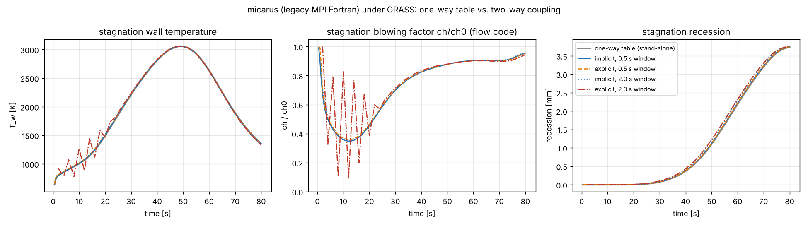

# icarus_legacy: a legacy-style MPI Fortran code adapted into GRASS

[`examples/mock_icarus`](../mock_icarus) showed the *shape* of wrapping a
Fortran material-response code: a few hundred lines written to be wrapped,
with a C interface from day one. This example asks the harder question:
**what does it take to bring a code that was written to run on its own
into GRASS, and where does GRASS get in the way?**

So `micarus` is written the way a production entry-systems code is: an MPI
program with its own `main`, its own time loop and adaptive step, its own
namelist input, its own output formats and per-rank restart files, global
module state, and a domain-decomposed unstructured finite-volume solver.
GRASS then drives it, without changing how it computes, and couples it
two-way to the aeroheating code from `mock_icarus`.

> **This is not Icarus.** It is about 1,500 lines of Fortran written from
> public descriptions of 3D unstructured material-response codes, mainly
> the NASA papers on Icarus ([Schulz et al., AIAA 2017-0667](https://ntrs.nasa.gov/citations/20170000384);
> [Schulz, TFAWS 2022](https://ntrs.nasa.gov/api/citations/20220013038/downloads/TFAWS-2022-Schulz.pdf)):
> unstructured finite volumes, Darcy flow of the pyrolysis gas,
> multi-component Arrhenius decomposition, a surface energy balance, mesh
> motion for recession, and coupling to CFD through surface environments.
> Those sources do not say what language Icarus is written in or how its
> parallelism is built; everything about micarus's software structure is
> an assumption about "a typical legacy code". The physics is a textbook
> subset and the numbers are plausible, not validated.

## The legacy code

```
fortran/
  mi_globals.f90    all program state as module variables, namelist defaults
  mi_parallel.f90   fatal errors (MPI_Abort), halo exchange, reductions
  mi_input.f90      namelist deck, aerothermal environment table, B' table
  mi_mesh.f90       spherical-cap heatshield mesh, column partition, ghost cells
  mi_solver.f90     BiCGSTAB with a through-thickness line preconditioner
  mi_physics.f90    one step: decomposition, Darcy pressure, energy, B' surface balance
  mi_output.f90     history, thermocouples, Tecplot surface files, restart record
  mi_driver.f90     initialize / advance_to / run / finalize
  micarus.f90       the program
  Makefile          the stand-alone build (mpif90)
```

**Physics.** Each step solves, with Picard iterations on the coupled
nonlinearities:

* decomposition of three components (two resin reactions and an inert
  fiber), `dρᵢ/dt = −Aᵢ exp(−Eᵢ/T) ρᵥᵢ ((ρᵢ − ρcᵢ)/ρᵥᵢ)ⁿⁱ`, integrated
  exactly over the step at the current temperature;
* the pyrolysis-gas pressure from Darcy flow with an ideal-gas density,
  linearised by one Newton step per iteration;
* energy, with conduction (k blended virgin/char, plus a radiative `T³`
  term), upwinded convection by the pyrolysis gas, and the heat of
  pyrolysis;
* a surface energy balance with B'c and wall enthalpy from a table
  (`cases/bprime.dat`, synthetic, from `tools/make_bprime.py`), solved
  through a linearised Robin condition;

then accepts the step, or rejects it and halves dt. On acceptance the
surface recedes and every column contracts (a landing-frame shortcut, like
the first mock). The surface environment (`ch`, `h_r`, `p_e`, `q_rad`)
comes either from a table vs. time and body angle (`bc_source = 'table'`,
the classic one-way hand-off) or from a host code (`'external'`). With
`blowing_correction = .true.` the code applies `ch/ch0 = φ/(e^φ − 1)`
itself; when coupled, the flow code does.

**Numerics and parallelism.** Cells and faces are stored as an unstructured
list (owner, neighbour, area, distance), even though the mesh comes from a
generator: a spherical-cap segment of `n_theta × n_phi` surface faces, each
the top of a column of `n_depth` cells clustered at the surface. Ranks own
contiguous blocks of columns plus one ring of ghost columns, exchange halos
with nonblocking point-to-point messages, and reduce with `MPI_Allreduce`.
The linear systems are solved with BiCGSTAB preconditioned by an exact
tridiagonal solve of each column. Results agree to about 1e-9 across rank
counts (only the reduction order differs) and are bit-identical for a
fixed rank count.

**Running it stand-alone**, the way its users always have:

```sh
make -C fortran
cd cases && mpirun -np 2 ../fortran/micarus oneway.nml
```

[`cases/oneway.nml`](cases/oneway.nml) is the classic one-way workflow: the
flow code was run along the trajectory without blowing
([`tools/make_env.c`](tools/make_env.c) produced
[`cases/env.dat`](cases/env.dat) from the mock aeroheating code), and
micarus applies the blowing correction from its own local blowing rate.

```
 ================================================================
  micarus 0.3 (mock)
  3D unstructured finite-volume pyrolyzing-ablator response
 ================================================================
  ranks 2, cells 2560, faces 6976
 step     400  t   19.3000  dt 5.00E-02  Tw_max  1516.9  picard  4  lin   61  rejected0
 ...
 restart written at t =   80.0000 (2 files)
 done: t =   80.0000, 1614 steps, 0 rejected, 95171 linear iterations
```

It writes `out/oneway_hist.dat`, `out/oneway_tc.dat` (four thermocouples),
160 Tecplot surface snapshots, and one restart file per rank.

## Bringing it into GRASS

The adapter has the same three layers as `mock_icarus`. Only the first
touches Fortran, and it sits *beside* the legacy code, not inside it.

1. **[`adapter/micarus_capi.f90`](adapter/micarus_capi.f90)** (≈150 lines):
   `bind(C)` wrappers over routines the program already calls:
   `micarus_init(comm, deck, overrides)`, `micarus_advance_to(t)`,
   surface geometry, `set_environment`, `get_surface`, save/restore of the
   state record, the code's own output and restart writers, and an error
   hook.
2. **[`src/lib.rs`](src/lib.rs) `Micarus`**: the safe owner. It passes the
   GRASS communicator as a Fortran handle
   (`grass_mpi::get_mpi_world_fortran_handle()`), writes an override
   namelist, enforces one instance per process, and turns status codes
   into `Result`s.
3. **`MicarusPlugin`**: reads `[icarus]`, publishes `SurfaceFaces`,
   `SurfaceEnv` (input) and `SurfaceState` (output), and registers one
   system that advances the code to the end of the current window with its
   own adaptive step.

The configuration stays the code's own deck. TOML points at it and
overrides any namelist variable:

```toml
[tps.icarus]
deck = "cases/oneway.nml"        # unchanged
[tps.icarus.set.boundary]
bc_source = "external"           # environment from GRASS
blowing_correction = false       # the flow code applies it
```

[`build.rs`](build.rs) compiles the Fortran (without `micarus.f90`), the
shim and `aero.c` with `mpif90`/`cc` and links the MPI Fortran runtime the
wrapper compiler reports.

### 1. Nothing changed: the stand-alone deck through GRASS

```sh
cargo build --release
(cd cases && mpirun -np 2 ../fortran/micarus oneway.nml)
mpirun -np 2 target/release/replay replay.toml
cmp cases/out/oneway_surf_0160.dat out/replay/oneway_surf_0160.dat    # identical
```

[`replay`](src/bin/replay.rs) runs the same deck with GRASS owning MPI, the
time loop and the output directory. Every file the code writes (history,
thermocouples, all 160 surface snapshots) is **byte-identical** to the
stand-alone program's. That is the first test any adaptation of a real
code should pass: the host changes who calls the code, not what it
computes.

### 2. Two-way coupled, each code on its own MPI ranks

```sh
mpirun -np 3 target/release/entry3d entry3d.toml     # flow on 1 rank, micarus on 2
target/release/entry3d entry3d.toml                  # or one thread per role, no mpirun
```

[`entry3d`](src/bin/entry3d.rs) runs the aeroheating code as role `flow`
and micarus as role `tps`. micarus decomposes its mesh over the role
communicator GRASS gives it, exactly as it would over `MPI_COMM_WORLD`.
The interface unknown is the wall blowing rate on every surface face,
sharded over the tps ranks in the code's own partition order:

* flow → tps: `ch` (blowing-corrected), `h_r`, `p_e` at 7 stations,
  interpolated linearly in body angle to each rank's faces;
* tps → flow: each rank's area-weighted partial sums of its faces' blowing
  per station, summed on the flow side into a station average.

`[coupling] scheme = "implicit"` iterates every 0.5 s window to a fixed
point with IQN-ILS, rolling both codes back with their own state records
(`DistributedImplicit`). `"explicit"` is one pass per window.

```
flow: 160 windows, 486 coupling iterations (3.04 per window, max 5), 0 unconverged, peak stagnation q_cw 580.4 W/cm2
tps: micarus on 2 rank(s): 64 faces, 1614 steps, 0 rejected, 235109 linear iterations (rank 0 counts)
tps: stagnation recession 3.743 mm, peak T_wall 3056 K; max recession 3.743 mm
```

### 3. What the coupling changes

[`study.py`](study.py) runs the stand-alone one-way case and the coupled
entry at two windows and both schemes, and the implicit case on 1, 2 and 3
micarus ranks ([`study_output.txt`](study_output.txt)):

| run | stagnation recession | coupling iterations / window | wall time |
|---|---|---|---|
| one-way table, stand-alone (micarus corrects for blowing itself) | 3.737 mm | – | 13.6 s |
| explicit, 0.5 s window | 3.743 mm | 1 | 10.0 s |
| explicit, 2 s window | 3.761 mm | 1 | 10.1 s |
| implicit, 0.5 s window | 3.743 mm | 3.04 | 28.3 s |
| implicit, 2 s window | 3.756 mm | 4.92 | 42.9 s |

| implicit, 0.5 s window | 1 micarus rank | 2 ranks | 3 ranks |
|---|---|---|---|
| wall time | 44.1 s | 28.3 s | 22.8 s |
| stagnation recession | 3.743 mm | 3.743 mm | 3.743 mm |

All runs on a 4-core VM, micarus on 2 ranks unless noted, flow on one more.



* **The legacy one-way workflow holds up here.** The one-way run, where
  micarus applies the blowing correction from its own local blowing rate,
  lands within 0.2% of the two-way coupled recession. That is because both
  use the same laminar correction formula; it is a statement about this
  model, not about real ablators. With a CFD code that resolves the
  injected gas, the two would differ.
* **A loose window oscillates early, as in the first mock.** With a 2 s
  explicit window the flow code's blowing factor swings between 0.1 and
  0.8 in the first 20 s, and the wall temperature follows. Implicit
  coupling at the same window tracks the 0.5 s solution. The integrated
  recession barely notices, because those windows carry little heat.
* **Implicit costs about 3× explicit at a 0.5 s window**, because each
  window is repeated about three times. At a 2 s window the iterations go
  up (4.9 per window) and so does the cost, because micarus's own
  adaptive step does the same work on every repeat.
* **The code's own decomposition works under GRASS.** Going from 1 to 3
  micarus ranks cuts the wall time from 44 s to 23 s on this small mesh
  (2,560 cells), with the same recession to the digits printed. The bits
  differ between rank counts because the reductions sum in a different
  order, exactly as they do when the program runs stand-alone.

## Friction: what the adaptation needed, and where GRASS got in the way

Short version: GRASS never needed to know how micarus computes, decomposes
its mesh, or solves its equations. The code runs as a black-box SPMD
program on whatever communicator it is handed, and that part worked the
first time. The friction is all at the edges: who owns MPI, time, input,
output, state and failure.

### Seams the legacy code had to have

micarus was written with these already in place, because without them no
host can drive it. In a real legacy code each is a small change, but each
has to exist, and finding every place that violates it is most of the work.

| seam | what it means | cost in a real code |
|---|---|---|
| communicator variable | every MPI call uses `mi_comm` (a dup of what it was given), never `MPI_COMM_WORLD` | a grep-and-replace, plus auditing libraries it calls (I/O, solvers) |
| conditional `MPI_Init` | initialise MPI only if nobody has; finalise only what you initialised | a few lines |
| `initialize` / `advance_to(t)` / `finalize` | the main loop split so a host can call one window at a time | often the biggest change: legacy main loops interleave I/O, step control and physics |
| state record in memory | the restart record can be packed to a buffer, not only written to per-rank files | moderate; everything not in the record (counters, cached fluxes) must not affect results |
| optional namelist groups + a second file | the deck can be overridden by a small file read after it | small |
| error hook | `mi_fatal` calls a host callback before `MPI_Abort` | small |

### Where GRASS got in the way

1. **The role communicator is called "world", and local mode shares one.**
   `grass_mpi::get_mpi_world_fortran_handle()` is the right call: under
   `mpirun` it returns the tps role's communicator, and micarus decomposed
   over it with no changes. But the name says "world", it is a free
   function rather than something on `RoleContext`, and in local mode
   (roles on threads, no `mpirun`) every role gets the same size-1
   `MPI_COMM_WORLD`. It works here because only one role calls MPI. Two
   MPI-using codes in local mode would share a communicator from two
   threads. *Suggestion:* `RoleContext::solver_comm()` and
   `solver_comm_fortran()`, giving each role its own communicator in both
   modes (a `MPI_COMM_SELF` duplicate per role in local mode).

2. **MPI is initialised at `MPI_THREAD_SINGLE`, but local mode runs roles
   on threads.** `grass_mpi` initialises MPI with rsmpi's `mpi::initialize()`
   (plain `MPI_Init`, which only promises `MPI_THREAD_SINGLE`), and in
   local mode micarus calls MPI from a role thread, not the main thread. Open MPI tolerates it; the standard does not promise it.
   *Suggestion:* request `MPI_THREAD_FUNNELED` or higher when the runner
   will run roles on threads, and fail loudly if the library refuses.

3. **One instance per process, for the life of the process.** micarus
   keeps its state in module variables and never frees its mesh, so it can
   be started once per process. GRASS assumes an App can be built as often
   as you like (tests, ensembles, sub-Apps). The adapter enforces this with
   an `AtomicBool` and a clear error. `cargo test` only covers the adapter
   pieces that do not start the code; the code itself is checked by the
   `replay` and `entry3d` runs under `mpirun`. An ensemble of micarus
   members would need one MPI role (process) per member. *Suggestion:* let
   a plugin declare itself a process singleton so the runner places it,
   instead of finding out at run time.

4. **The code owns time; GRASS ticks windows.** micarus chooses, grows and
   cuts its own step and can reject a step. The adapter maps one GRASS tick
   to `advance_to(end of window)`. Two details mattered: the window end is
   derived from the code's own clock, not from a tick count on the GRASS
   side, so a rollback needs no extra bookkeeping; and it uses the same
   arithmetic as the stand-alone main loop, which is what makes the replay
   byte-identical. GRASS's `SimClock` and stage step counts do not describe
   this code, so `[[run]]` stages and `[checkpoint] every` in steps do not
   map onto it.

5. **Two configuration systems.** The deck stays the source of truth;
   TOML points at it and overrides namelist variables. It works, but
   `--config-docs` can only describe `[icarus.set]` as an opaque table,
   unknown namelist names are only caught by the Fortran reader at run
   time, and the legacy code resolves `env_file` and `bprime_file` against
   the *process* working directory, which a host does not control, so the
   adapter rewrites them as absolute paths. Provenance hashes the TOML and
   the Fortran sources, but not the deck or the override file it generated.
   *Suggestion:* a provenance hook for "foreign inputs" (deck and generated
   files, by hash).

6. **Output belongs to the code.** micarus writes its own history,
   thermocouple, Tecplot and restart files. Under implicit coupling it
   would write them on every iteration, so the coupled driver turns the
   plugin's output off and calls `write_output()` only for accepted
   windows. Its step log still prints during iterations that are later
   rolled back. GRASS's TermOut and CSV writers only see what the adapter
   copies into resources.

7. **Checkpoints are per rank and rank-count specific.** The code's restart
   files only reload at the same rank count, and its in-memory record is
   per rank. That is enough for implicit rollback (each rank saves and
   restores its own piece), but `grass_io`'s `CheckpointPlugin` writes one
   file per process with no notion of a distributed resource, so this
   example does not wire GRASS checkpoints to micarus at all.

8. **Fatal errors cannot unwind.** Most failures inside micarus end in
   `MPI_Abort`; the hook lets GRASS log first, nothing more. The two
   recoverable failures (step underflow, burn-through) come back as status
   codes and become a panic, and then `CoupledRunner` aborts the job. For
   implicit coupling the natural response to a step underflow would be to
   retry the window shorter, but `DistributedImplicit` has no "this iterate
   failed" path.

9. **The interface vector is distributed, but the accelerator is sized
   globally.** The blowing rate is sharded over the tps ranks in the code's
   own partition order, which `DistributedImplicit` handles well: it
   gathers the shards to one rank, runs IQN and scatters back. But the
   `OuterIteration` on that rank has to be created with the *global* length
   up front. The first version passed the local length and failed an
   assertion on the first window. *Suggestion:* size it from the first
   gather.

10. **Station ↔ face transfer is hand-written.** The flow code's 7 stations
    sit at body angles; micarus's faces are spread over ranks. `grass_map`
    maps between discretizations inside one process, and its built-ins are
    3D point clouds, grids and triangles, so a 1D-in-angle hat map plus a
    cross-rank sum for the conservative direction is about 60 lines in
    `StationMap`. With a real CFD surface mesh this would be a
    `TriSurface` map, but the cross-rank reduction would still be the
    driver's job.

11. **Building against MPI Fortran.** `build.rs` has to ask the wrapper
    compiler for the Fortran MPI link line (`--showme:link` for Open MPI,
    `-link_info` for MPICH), and the `mpi` module files only work with the
    same gfortran the MPI was built with. rsmpi links through `mpicc`, so
    the two must come from the same MPI installation. None of this is
    GRASS's fault, but every user will hit it.

What did *not* cause friction: the halo exchange, the Krylov solver and
the domain decomposition needed nothing from GRASS; `CoupledRunner`
placed the roles and `DistributedImplicit` rolled both codes back together
across ranks; and the same driver ran under `mpirun` and on threads.


## Layout

```
fortran/               the legacy code and its Makefile
adapter/micarus_capi.f90   the C interface (adapter layer 1)
src/lib.rs             Micarus (layer 2), MicarusPlugin (layer 3), Aero, StationMap
src/bin/replay.rs      the stand-alone deck through GRASS
src/bin/entry3d.rs     the two-way coupled entry on MPI roles
tests/adapter.rs       station/face transfer and override-writer tests
cases/                 oneway.nml, env.dat (from tools/make_env.c), bprime.dat (from tools/make_bprime.py)
replay.toml, entry3d.toml, study.py
```

Requirements: an MPI installation with Fortran bindings (OpenMPI or MPICH)
built with the same `gfortran` you use, a C compiler, and Rust 1.80 or
newer. The example has its own Cargo workspace, so building GRASS itself
never needs Fortran or MPI.
